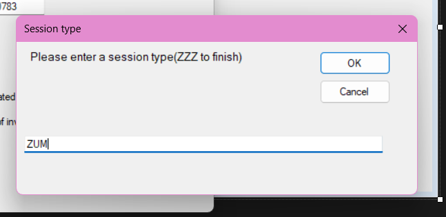
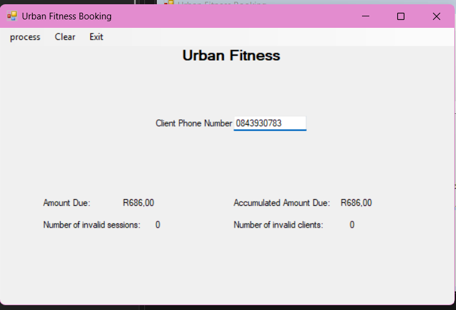

# Urban Fitness Booking System 🏋️‍♂️

A desktop application built with **C# and Windows Forms (.NET Framework)** designed to manage gym session bookings, validate client details, and process session totals with dynamic discounts.

---

## 📸 Application Demo

### Session Input Dialog


### Final Calculation & Financial Summary


---

## ✨ Features
* **Sentinel-Controlled Loops:** Continuously processes session codes (`PAD`, `ZUM`, `GYM`) using a sentinel loop (`ZZZ`) until entry is complete.
* **Robust Input Validation:** Validates client contact numbers and session types, handling exceptions and accumulating invalid entry counters.
* **Automated Bulk Discounts:** Calculates total booked hours and automatically applies a 2% bulk discount when bookings exceed 5 hours.
* **Financial Accumulators:** Tracks individual transaction totals while maintaining a running total of accumulated revenue across sessions.

---

## 🛠️ Tech Stack
* **Language:** C#
* **Framework:** Windows Forms (.NET Framework)
* **IDE:** Visual Studio 2022

---

## 🚀 How to Run
1. **Clone the repository:**
   ```bash
   git clone [https://github.com/lunomalangabi/UrbanFitnessBooking.git](https://github.com/lunomalangabi/UrbanFitnessBooking.git)
